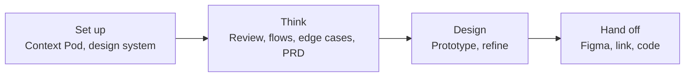

Go straight to screens and you get surface-level design. Think through the product first and the design has a reason to exist.

A strong Figr workflow, especially inside an existing product, looks like this:

<Steps>
  <Step title="Set up product context">
    Build a [Context Pod](/product-intelligence/context-pods) with a walkthrough of the area you're working on.
  </Step>
  <Step title="Set up your design system">
    Add your [Design System](/product-intelligence/design-system) so every screen uses your components and tokens.
  </Step>
  <Step title="Add inputs for this task">
    Attach screenshots, Figma frames, PRDs or data. See the [input guide](/input-research/input-guide).
  </Step>
  <Step title="Explore and review">
    [Brainstorm](/getting-started/tutorial/brainstorm) approaches, or ask for a [UX review](/getting-started/tutorial/review) of what exists today.
  </Step>
  <Step title="Map flows and edge cases">
    [Map the flow and its edge cases](/getting-started/tutorial/map-edge-cases) before any screen is built.
  </Step>
  <Step title="Write the PRD">
    [Create a PRD](/getting-started/tutorial/create-prds) that captures the decisions.
  </Step>
  <Step title="Build the prototype">
    [Generate the prototype](/getting-started/tutorial/prototypes) with all its states.
  </Step>
  <Step title="Refine it">
    [Edit without regenerating](/getting-started/tutorial/untitled-page-5) to fix details in place.
  </Step>
  <Step title="Hand off">
    [Export, publish or hand off](/export/options) to Figma, a link or a coding agent.
  </Step>
</Steps>

You don't need every step every time. For a small change, go from context straight to the prototype and refine it.
