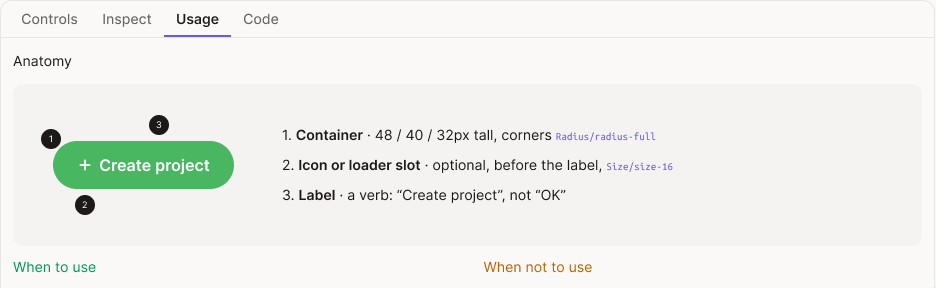

Most teams have two design systems that are supposed to be one: the library in Figma and the components in code. They drift. The same grey in Figma turns out to be black in Storybook, and teams patch every AI prompt with a line telling it not to invent local components.

AI tools make the drift worse, because they copy whatever they see. Figr reads every place your system lives, builds one system from it, and writes down when to use each part, so Figr, your designers and your engineers' coding agents all follow the same rules.

<Frame>
  
</Frame>

<Tip>
  **The short version:** connect Figma, code and anything else your system lives in. Optionally walk Figr through it. Figr's design system agent builds the system, asks you about the parts it can't decide alone, and writes usage guidelines for every token and component. You review it before anything goes live.
</Tip>

Setup has three steps: **Sources → Explain → Build**. The system gets a name automatically (you can rename it), and you share it at the end.

## 1. Sources: tell Figr where your system lives

Most systems are split across a few places. Add all of them; Figr reads them together.

<Frame>
  
</Frame>

| Source | How it connects |
| --- | --- |
| **Figma** (recommended) | The Figr Sync plugin, run inside your library file. You can also upload a `.fig` file. |
| **Code** (recommended) | GitHub, GitLab, Bitbucket or Azure; a public or private npm package; or a folder or `.zip` of your code. |
| **Storybook** | Your published Storybook link. |
| **External sources** | AI design tools, coding agents and exported files: run one command, or upload an export. |
| **Product screens** | Screenshots of real screens, so Figr sees how components work together. |
| **Connectors** | Notion, Confluence, Miro, Linear, Slack, Mixpanel, Amplitude, PostHog, Granola, Excalidraw and more, or a custom connector. Read-only; disconnect at any time. |

Connect **Figma and code together** for the most accurate result. Either one alone works, and so does Storybook with no Figma or code. Product screens alone are not enough to build a system.

## 2. Explain: walk Figr through it (optional)

Tell Figr what the sources don't say: which component to use when, what is outdated, and what you usually fix in review.

- **Record a walkthrough.** Share your screen and talk through your system. You preview the recording before adding it.
- **Add notes and references.** Type instructions and attach images: what to trust, what's outdated, what to fix.
- **Add brand assets.** Icons, logos, fonts and illustrations.

Skip this step and Figr builds from the sources alone.

## 3. Build: the design system agent builds it with you

The design system agent takes over the screen and builds tokens, components and guidelines, explaining what it's doing as it goes. Expect a few minutes.

When your sources disagree or leave a choice open, the agent stops and asks instead of guessing. It tells you how many decisions it needs ("I captured 24 components from your Figma file. Before I rebuild them, I need you to decide 5 things.") and shows them one at a time.

<Frame>
  
</Frame>

Each question:

- **Shows the part it's about.** A preview from your Figma file with the part highlighted, and a link to open it in Figma.
- **Says why it matters.** For example: "This decides whether you can reuse the arrow in other components."
- **Offers answers, one marked Recommended.** Some questions show two versions side by side so you can pick by looking.
- **Lets you answer your own way.** Choose **Something else** to type an answer, **Not sure? Help me answer** for an explanation, or **Skip**.

You can move back and forth between questions. Once all are answered, the agent updates the affected components. **Nothing goes live until you review the changes.**

<Note>
  If Figma disconnects mid-build, reopen the Figr plugin in your file and click **Reconnect** to continue.
</Note>

## What you get

A design system page your whole team, and every AI tool, reads from. It has versions, and you can export or share it.

**Tokens & Styles**: colors, typography, dimensions (spacing, radius, border width) and effects (shadow, blur). Every token has:

- its value, per mode when your system has modes (for example, one per brand)
- a usage guideline, such as "Padding inside cards and fields"
- where it's used, such as "Used in InputField, Modal"

Tokens without a guideline say **No guidance yet**, so gaps are visible instead of silent.

**Components**: each component has four tabs.

| Tab | Shows |
| --- | --- |
| **Controls** | A live preview; change variant, size and mode. |
| **Inspect** | The tokens on each part, and text contrast against WCAG AA. |
| **Usage** | Anatomy, when to use, and when not to use with what to use instead. |
| **Code** | A copyable example from your package that matches the controls. |

<Frame>
  
</Frame>

**Assets & Logo**: logos, the icon library and illustrations, each with when to use it.

**Documents**: the files, notes and recordings you added as context.

To change anything later, ask the design system agent in the side panel.

## Mismatches between Figma and code

Figr lists every place Figma and code disagree: colors, spacing, variants, and components that exist on only one side.

<Info>
  Available only on Enterprise.
</Info>

## What changes for your team

- **Design system teams** see drift and missing guidance in one place instead of finding it in production.
- **AI tools** stop inventing components, without prompt patches.
- **Every screen Figr makes** uses the system your engineers actually ship.

## Go further

Put the system to work in engineering. Coding agents read it through Figr MCP.

<Card title="Figr MCP" color="#695BE8" icon="server" horizontal href="/export/mcp" arrow>
  Let coding agents read your design system and designs.
</Card>

## Get started

Want help with a large or split system? A Figr engineer can set it up with your team. Click **Get help setting up** in the setup screen, or book a call.

<Card title="Book a setup call" color="#695BE8" icon="calendar" horizontal href="https://figr.design/contact" arrow>
  Plan your design system setup with a Figr engineer.
</Card>

## Related

<CardGroup cols={2}>
  <Card title="Design system" color="#695BE8" icon="palette" href="/product-intelligence/design-system">
    How Figr learns and applies your tokens and components.
  </Card>

  <Card title="Add brand assets" color="#695BE8" icon="image" href="/design-system/brand-assets">
    No system yet? Start from your logo, icons and screenshots.
  </Card>
</CardGroup>
