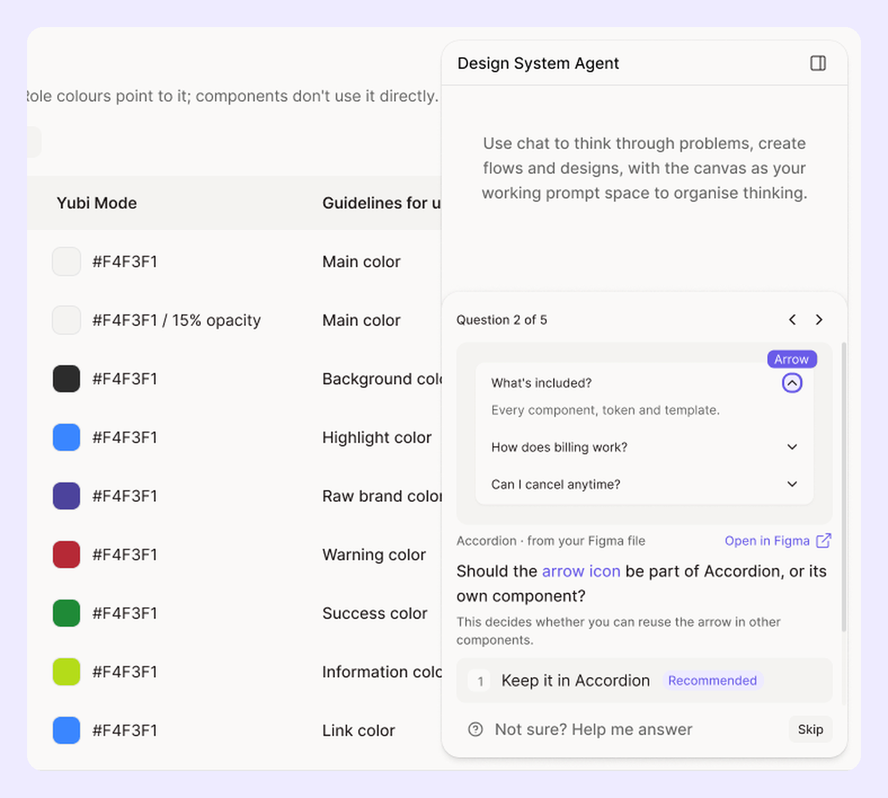
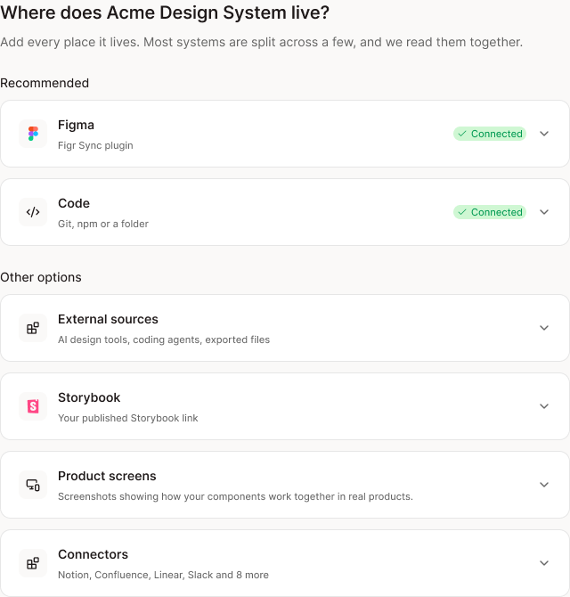
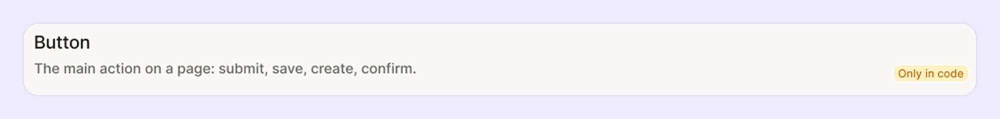

Your Figma library and your coded components drift apart, and AI tools copy whatever they see. Figr reads both, builds one system with a usage guideline for every token and component, and keeps every AI tool on it.

<Frame>
  
</Frame>

## Set it up

<Steps>
  <Step title="Start a new design system">
    In the sidebar, click **Design System**, then **New Design System**.
  </Step>
  <Step title="Add your sources">
    Add every place your system lives. Figma and code together give the most accurate result.

    <Frame>
      
    </Frame>
  </Step>
  <Step title="Explain it (optional)">
    Record a quick walkthrough or add notes: which component to use when, and what's outdated.
  </Step>
  <Step title="Answer the agent's questions">
    The Design System Agent builds your tokens, components and guidelines. Where your sources disagree, it asks instead of guessing, and shows you the exact part from your Figma file.

    <Frame>
      
    </Frame>

    Nothing changes until you review it.
  </Step>
</Steps>

## What you get

A design system page with tokens, components, documents and assets, each with when to use it. Ask the Design System Agent in the side panel for any change.

Every component has **Controls**, **Inspect**, **Usage** and **Code** tabs.

<Frame>
  
</Frame>

<Info>
  **Enterprise:** each component shows whether it is in Figma and code, or only in one.

  
</Info>

## Next

<CardGroup cols={2}>
  <Card title="Figr MCP" color="#695BE8" icon="server" href="/export/mcp">
    Let coding agents read your design system.
  </Card>

  <Card title="Book a setup call" color="#695BE8" icon="calendar" href="https://figr.design/contact">
    Set up a large or split system with a Figr engineer.
  </Card>

  <Card title="Design system" color="#695BE8" icon="palette" href="/product-intelligence/design-system">
    How Figr applies your tokens and components.
  </Card>

  <Card title="Add brand assets" color="#695BE8" icon="image" href="/design-system/brand-assets">
    No system yet? Start from your logo, icons and screenshots.
  </Card>
</CardGroup>
